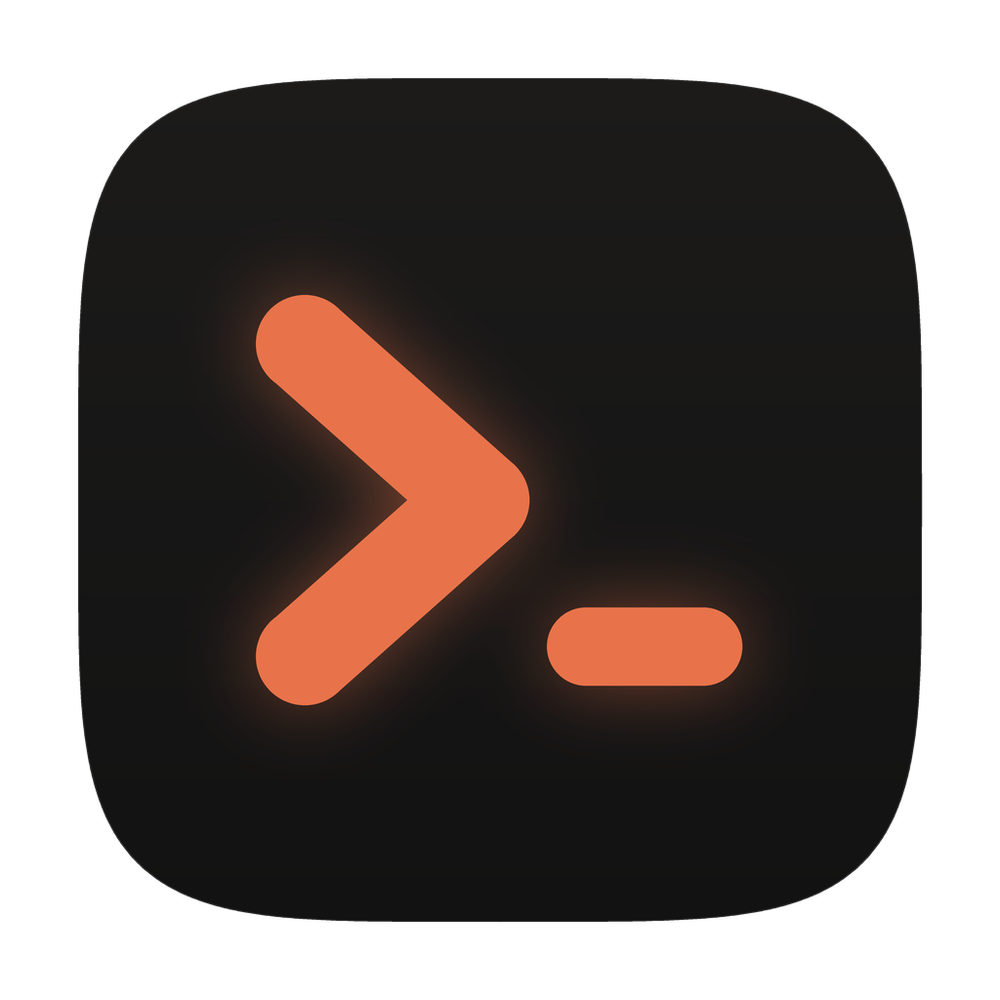

<p align="center">
  
</p>

<h1 align="center">Codesh</h1>

<p align="center">A macOS terminal workspace for running agents and shells, built with Rust, GPUI and libghostty.</p>

## What it is

Codesh organizes your work by project and Git worktree. Each project has one
workspace of equal-sized split panes, and every terminal runs in a background
server, so agents and shells keep going when you close the window. Files,
Source Control, editors, diffs and a browser are built in, and the same
workspace reaches other machines over SSH.

## Features

- **Split panes per project.** One workspace per project or worktree, split
  into equal-sized, card-style panes with headers.
- **Worktree activity in the sidebar.** Each worktree shows a card with its
  agent state, latest session or pull request, and branch.
- **AI agent awareness.** Codesh recognizes Claude Code, Codex and other agents
  in its terminals and notifies you when one needs input.
- **Native Files and Source Control panels.** Browse files, stage, discard and
  commit, and open files in an editor with syntax highlighting or in diff panes.
- **Go to File and Find in Files.**
- **Built-in browser** panes, scriptable from the shell with `codesh browser`.
- **Background sessions.** Terminals run in `codesh-server` and survive quitting
  the app.
- **Remote servers over SSH.** Each machine runs its own `codesh-server`; the
  `codesh` CLI and terminal UI work locally or with `--host`.
- **Settings** in a window modeled on macOS System Settings.

## Install

Codesh runs on macOS 14 or newer, on Apple Silicon or Intel.

1. Download `Codesh-<version>-arm64.dmg` (Apple Silicon) or
   `Codesh-<version>-x86_64.dmg` (Intel) from the
   [latest release](https://github.com/hugocxl/codesh/releases/latest).
2. Drag **Codesh** to `/Applications` and open it.

The app updates itself from GitHub Releases. To use `codesh` in your shell,
choose **Install Command Line Tool…** from the app menu.

The CLI and server alone, for Macs and Linux machines you reach over SSH, are
also on the Releases page. See [Getting started](docs/user-guide/getting-started.md).

### Build from source

You need [Rust](https://rustup.rs) (`rustup` installs the toolchain pinned in
`rust-toolchain.toml`) and [Zig](https://ziglang.org) **0.15.2**, which builds
the Ghostty terminal library. Use exactly that Zig version.

```bash
git clone https://github.com/hugocxl/codesh.git
cd codesh
cargo build --workspace
cargo run -p codesh-app
```

`python3 scripts/build-install.py` builds a signed app for this Mac and installs
it; `--build-only` stops after signing. See [CONTRIBUTING.md](CONTRIBUTING.md)
for development details.

## Usage

1. **Add a project:** **Add Project** in the sidebar, `Cmd+O`, or
   `codesh <folder>` from a shell.
2. **Open terminals:** `Cmd+T` adds a terminal pane; `Cmd+D` and `Cmd+Shift+D`
   split right and down.
3. **Work with files:** `Cmd+E` toggles Files, `Cmd+Shift+G` Source Control,
   `Cmd+P` is Go to File and `Cmd+Shift+F` Find in Files.
4. **Quit freely:** terminals keep running, and Codesh restores everything on
   the next launch.

More in the [documentation](docs/README.md).

## Project layout

| Path | Contents |
| --- | --- |
| `crates/codesh-app` | The macOS desktop app (GPUI) |
| `crates/codesh-ui` | Reusable GPUI components and native web views |
| `crates/codesh-app-core` | App model without UI: layouts, workspaces, settings |
| `crates/codesh-cli` | The `codesh` CLI and terminal UI |
| `crates/codesh-server` | `codesh-server`: projects, sessions, history, Git, files |
| `crates/codesh-terminal` | Ghostty terminal and PTY wrapper |
| `crates/codesh-client` | Client connections to local and remote servers |
| `crates/codesh-protocol` | Wire protocol and transports |
| `crates/codesh-mobile` | Client library for mobile apps |
| `crates/codesh-core` | Shared basics: folders, locks, shortcut catalog |
| `docs/` | User guide, feature docs, product and technical design |

## License

[MIT](LICENSE). Codesh is developed and maintained by Hugo Corta.

Codesh is derived from [Muxy](https://github.com/muxy-app/muxy) (MIT); `LICENSE` keeps Muxy's copyright notice.
