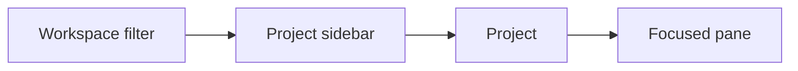
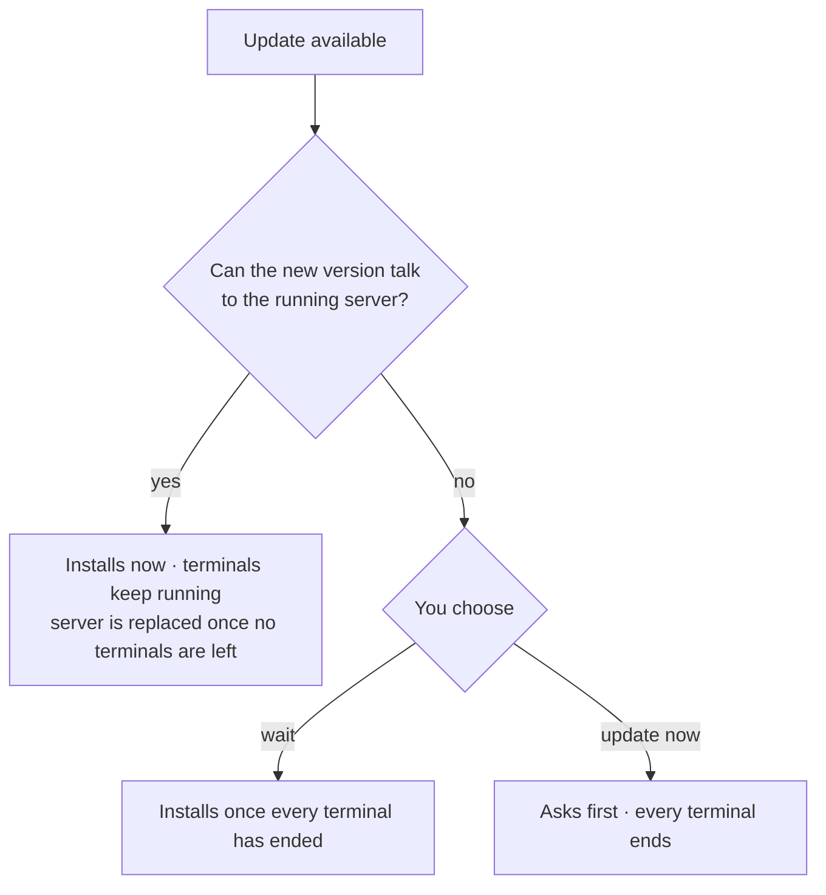

# App model

How people use Codesh: the apps, navigation, settings, and updates.

## The apps

| App | Connects to |
| --- | --- |
| Desktop app (macOS) | The server on the same computer, starting it if needed, and the servers of remote devices over SSH. |
| `codesh` terminal UI | The server on the same computer, starting it if needed, or with `--host`, the server on another computer over SSH. Ships with the desktop app and also on its own. |
| Phone client | A paired computer's server, over the local network or a VPN, or any computer's server over SSH. Built on `codesh-mobile`; Codesh does not ship one. |

Every project knows which server it lives on, so the desktop app shows
projects from several servers in one sidebar. Remote projects are marked with
their server and path. There is no global "current server".

The host menu at the bottom of the sidebar shows each remote server's state.
Its popover adds servers (host, user, port, key file, or a password that
Codesh asks for and keeps only in memory) and manages them. **Add Project →
Remote** browses that server's folders. When a server lacks Codesh, a released
app offers to install the same version there; when its version can't talk to
the app, the menu explains how to update it. Removing a server only forgets
its projects in this app.

Servers can be put in groups. **Manage Remote Servers…** opens the Remote
Servers pane, which lists every server by group and connects, disconnects, regroups,
or removes several at once. Disconnecting leaves a server's terminals running
there.

**New Terminal in Project…** (⌘⇧N) lists local and remote projects. Picking one
opens a terminal there and switches workspace if needed; a remote server opens
in its Home, connecting first if needed.

Files and images dropped or pasted on a remote terminal are copied to that
computer and their paths are pasted. Clicking a file
path in a remote terminal offers a read-only copy here, or its path.

Each app keeps its own layout: splits, workspaces, and project order.
Projects and terminals are shared. Several `codesh` windows can open the same
terminal UI layout.

## Navigation



- The sidebar shows **All projects** by default. Pick a workspace to filter it.
  Home stays first and worktrees appear under their parent.
- One project order applies under every filter.
- Picking a project shows its split layout. The Files or Source Control panel
  can be pinned on the right.
- A window has one focused pane. Closing it moves focus to a neighbor. Closing
  something in the background never steals focus.

## Opening and restoring

- The desktop app restores all projects, panes, and window state on launch. It
  never opens a terminal by itself.
- The terminal UI opens one shell in Home the first time, then restores its
  layout.
- `codesh <folder>` opens the folder in the desktop app, selecting its project or
  adding one. Without the desktop app, or over SSH, it opens in the terminal UI.
- **Existing Terminals** lists a project's terminals that this app isn't
  showing, and which app owns each one. Opening one adds it to your layout.

## Worktrees

New Worktree has a name, a new or existing branch, and Default, Template, or
Folder location choices. Worktrees default to `~/.codesh/worktrees/<project>/<name>`.
Settings → General sets the global location; each project remembers its choice. Templates support `{branch}`, `{base-dir}`, and `{project-name}`.

Optional setup and teardown commands come from the source project's
`.codesh/worktree.json` and `$XDG_CONFIG_HOME/codesh/worktree.json` (by default,
`~/.config/codesh/worktree.json`):

```json
{ "setup": ["npm ci"], "teardown": ["docker compose down"] }
```

Review and enable commands when creating or removing a worktree; `codesh worktree`
runs them only with `--hooks`. Setup runs per-machine commands first; teardown
runs project commands first. Commands run in the worktree, with
`CODESH_PROJECT_PATH` and `CODESH_WORKTREE_ID`, `CODESH_WORKTREE_PATH`,
`CODESH_WORKTREE_NAME`, and `CODESH_WORKTREE_BRANCH` available.
A setup failure keeps the new worktree; a teardown failure stops removal.

## When things go away

| Situation | What you see |
| --- | --- |
| The server is offline | Projects stay visible, terminals keep their last screen, and web panes keep working. Edits and closes are replayed on reconnect. |
| A remote server drops | Its section shows it offline and it reconnects on its own, waiting longer each time, until a login or host key needs you. Its projects never show as failed while offline. |
| A project's folder is gone | The project shows as failed, also on a remote server. |
| A terminal ends | Its panes close in every app, including hidden ones. |
| You quit or detach | Terminals keep running. |
| **End All Sessions and Quit** | Every terminal on this computer ends and its panes close. Other panes stay. |

A server's menu connects it and restarts or stops its `codesh-server`.

## Proxy

**Set Up Proxy…** in a terminal's right-click menu configures one HTTP or SOCKS5 proxy, with an
optional login, kept privately and left out of backups. **Use for the whole app**
sends new terminals on this computer, Codesh's own downloads, and SSH to remote
servers through it. Otherwise, right-click a terminal and choose **Apply
Proxy**: it restarts in the same folder with the proxy, and its pane shows a
proxy icon. Terminals get the proxy as `http_proxy`, `https_proxy`,
`all_proxy`, and `no_proxy`. Running terminals keep what they started with.

## Settings

- Settings is one window, separate from projects, laid out like macOS System
  Settings. It works while offline, and changes apply immediately. See
  [Settings window](../codesh/settings.md).
- App preferences live in `settings.toml`, terminal preferences in
  `terminal.toml`, and custom themes in `themes/`.
- Every app shortcut can be changed in Settings → Keyboard. Terminal key
  bindings are set in Settings → Terminal. Normal keystrokes in a terminal go to
  the terminal.
- The interface uses the built-in English catalog.
- Server settings, such as the shell and history size, apply to this
  computer's server. `codesh --host` changes another computer's. Stopping or
  restarting it asks first.
- **Settings → Mobile** turns phone access on, shows a pairing code, and lists
  paired phones. `codesh mobile` does the same without the desktop app.
- **Settings → Backup & Restore** exports settings, themes,
  projects, and layouts. Restore applies on the next launch and keeps a recovery
  copy in `Backups`. Existing projects are kept; matching projects receive the
  saved layouts. Server settings take effect after restarting the server.
- Config files open in the system editor. Backups exclude live terminal sessions,
  paired-device credentials and project files. They keep
  the list of remote servers but not remote projects, which come back from
  their server.

## Updates



When the new version can talk to the running server, checking **Also restart
the server** in the update dialog replaces the server now too. Every terminal
ends.

## Desktop features

- **Native panels.** [Files](../features/files.md) and
  [Source Control](../features/git.md) panels pin on the right of the current
  project. Files open in editor panes with syntax highlighting; changes open in
  diff panes. Go to File and Find in Files search the project on its server.
- **Browser.** Browser panes use the system web engine.
- **Sidebar.** Worktrees show as activity cards with agent state, latest
  session or pull request, and branch.

## AI agents

The server recognizes AI coding agents running in terminals and whether each
one is working, waiting for you, or done.

- Worktree cards show the state of their agents, and "waiting for you" comes
  first.
- The desktop app notifies you about agents in the background. Looking at the
  terminal clears the alert in every app.
- Detached terminals show no alerts, and no notification history is kept.
