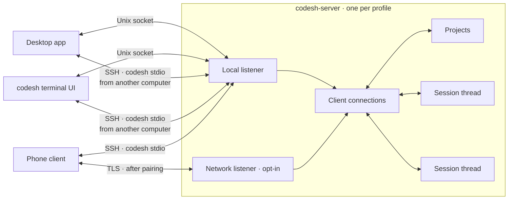
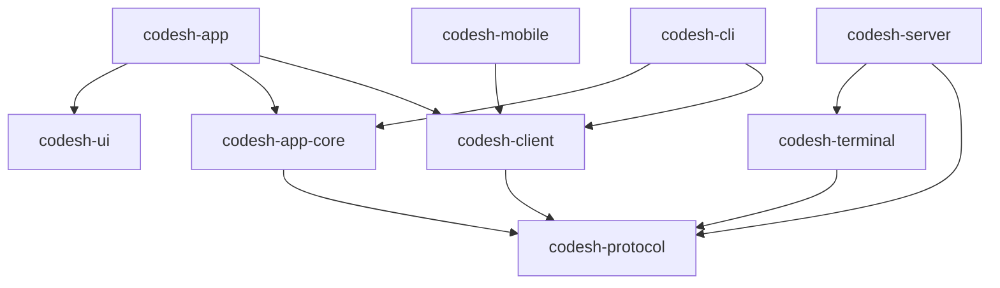
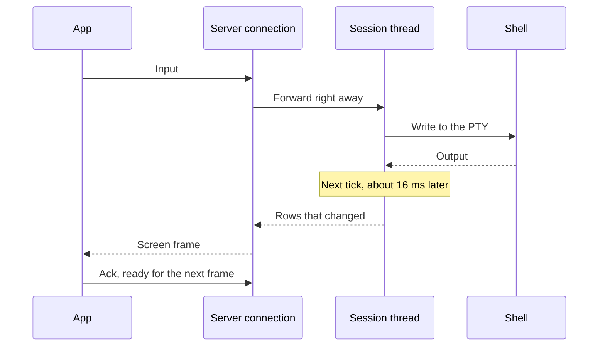
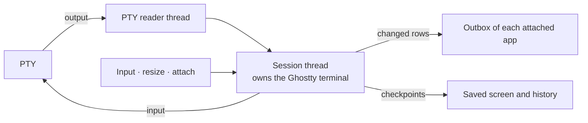
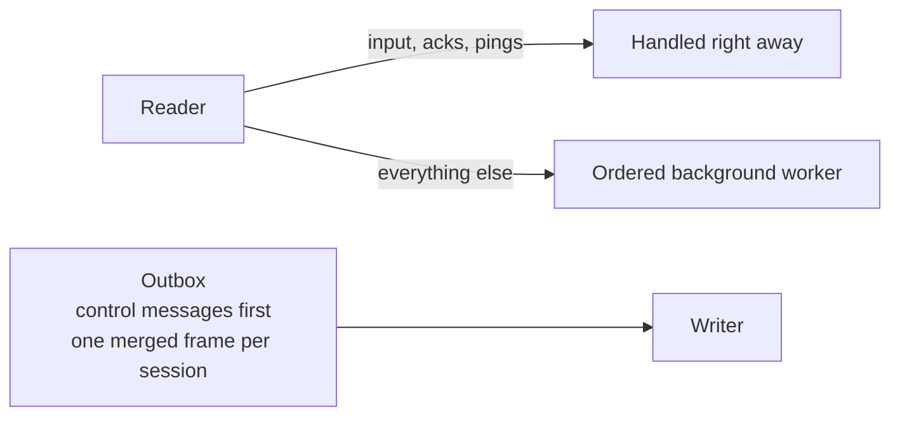

# Architecture

The processes, the crates, and how data moves between them.

## Processes

- The desktop app ships the `codesh` and `codesh-server` executables, which are
  also released on their own. Either app starts the server if it isn't running.
- The server keeps projects and which sessions belong to them. Apps keep
  layouts, panes, order, and workspaces.
- The desktop app keeps a connection per server: this computer's, and one per
  remote device. A second connection to each carries native panel work and remote
  file transfers, so they never wait behind terminal traffic.
- Apps never include server code. They only speak the [protocol](./protocol.md).

## Crates

| Crate | Role |
| --- | --- |
| `codesh-app` | The desktop app. |
| `codesh-ui` | Reusable GPUI components and native web views. No app state. |
| `codesh-app-core` | The app model without UI, shared by desktop and terminal UI: layouts, workspaces and settings. |
| `codesh-cli` | The `codesh` command: CLI and terminal UI. |
| `codesh-client` | Connects to a server, starting a local one if needed. |
| `codesh-mobile` | The client library for phones, with Swift and Kotlin bindings. |
| `codesh-protocol` | Messages, encoding, screen types, and transports. |
| `codesh-server` | The server: projects, sessions, history, Git, files, and mobile access. |
| `codesh-terminal` | Wraps the Ghostty terminal and the PTY. |
| `codesh-core` | Shared basics, such as folders, locks, the shortcut catalog, and UI strings. |

## Typing a key

## Inside a session

- One thread owns each terminal for its whole life. The Ghostty terminal isn't
  thread-safe, so everything else sends that thread messages.
- A separate thread only reads the PTY and forwards bytes. Chatty programs
  produce many tiny reads.
- Every tick, if anything changed, the session sends the changed rows and the
  cursor. If nothing changed, nothing is sent.
- When output goes quiet after a burst, history is compressed.
- A background writer saves the screen and history, so they survive the program
  and the server.

## Inside a connection

- Each app has its own connection and outbox, so a slow app never slows a fast
  one.
- The reader never waits on disk or on starting processes.
- Screen updates merge: a newer frame folds into the one not yet sent, which
  goes out once the app acknowledges the previous one.
- Replies and other control messages never wait behind screen data.

## Drawing in the app

- For each visible terminal, the app keeps the screen rows as styled runs, plus
  any history it has fetched.
- It repaints a pane only when a frame arrives or the view changes: one text
  line per row and one rectangle per color run.
- Hidden terminal panes detach but keep their last screen and scroll position
  in memory, and the server still counts them as showing their session. They
  attach again when shown, displaying cached content first, even while offline.
- The UI is built from `codesh-ui` components. Every app shortcut comes from one
  catalog, resolved through the keymap. Terminal preferences and key
  bindings live in `terminal.toml`.

## Browser and native panels

Files, Source Control, editor, and diff surfaces are native GPUI views in
`codesh-app`. The editor highlights syntax with `syntect`. File, Git, search
(`rg`, or `git ls-files` for Go to File), and process operations run on the
project's server through the side connection, so local and remote projects
behave the same. Browser panes use WebKit and share the occlusion and resize
infrastructure.

## The browser

- Browser panes embed [polybrowser](https://github.com/saeedvaziry/polybrowser),
  which wraps the system WebKit view and keeps profiles and history.
- A page sits in a native host, so it hides under
  app content and shares the keyboard with Codesh's shortcuts.
- The server knows nothing about browsers. `codesh browser` reaches the desktop
  app over its own socket in the profile folder, `app.sock`, which only this
  user can open. One JSON request gets one JSON reply.

## AI activity

- Each session thread checks the running program, the title, and the screen
  against built-in rules to find agents and their state.
- Apps get agent status from the server. They never read terminal output
  themselves.
- One desktop app delivers system notifications, so alerts are never doubled.

## Updates

- If the new app speaks the running server's protocol version, the server keeps
  running and is replaced once no terminals are left.
- Otherwise the update waits for every terminal to end, or ends them after the
  user confirms.
- The old app bundle is kept until its server exits.
- Linux user installs switch one symlink between complete version directories.
  Runtime leases keep old helpers available while apps, CLIs or servers use
  them; one previous version is also retained for rollback. Download checksums,
  package manifests and all three executable build identities are verified
  before activation. Package-manager paths are never replaced by this updater.
