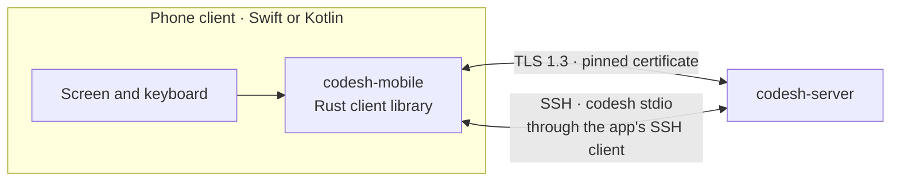
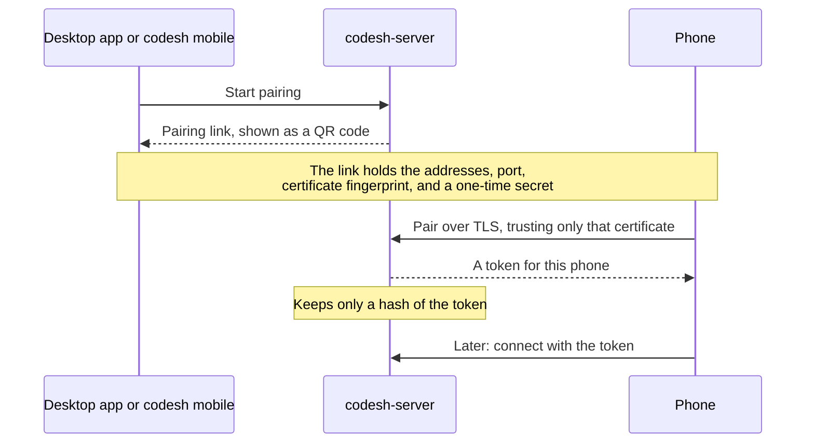

# Mobile

Phones connect straight to `codesh-server` on the user's computer. There is no
cloud service. A phone connects in one of two ways:

- **Paired, over TLS.** The phone reaches the computer on the same network,
  through a VPN such as Tailscale, or at an address added to the pairing code.
- **Over SSH**, with the phone client's own SSH client. It runs `codesh stdio` on
  the computer, like `codesh --host` does, so no pairing or open port is needed.

## Pairing

The computer lists its own addresses. One that phones reach by another name,
such as a cloud server behind NAT, puts that name first with
`codesh mobile pair --address`.

## Security

- Mobile access is off until the user turns it on.
- The phone trusts only the certificate named in the pairing code, so another
  machine can't pretend to be the computer.
- Each phone has its own token and can be revoked at any time. Revoking closes
  its connection at once.
- A connection that hasn't signed in gets nothing else from the server.
- Paired phones can't manage mobile access, change server settings, stop the
  server, or run programs outside a terminal (`exec`).
- Over SSH, the phone logs in as the user and can do what that login can. Host
  keys and credentials stay in the app's SSH client.

## The SDK

- `codesh-mobile` wraps the shared Rust client with UniFFI, which generates Swift
  and Kotlin bindings. Phones use the same protocol and flow control as the
  desktop app.
- The SDK keeps each attached screen up to date. The app draws it and sends
  input.
- `scripts/build-mobile-sdk.sh` builds the SDK for iOS and Android. Releases do
  not publish it.
- A phone works with any server that shares its protocol version, so phone
  client releases only need to follow breaking protocol changes.

The full integration guide, with the API, setup, and error handling, is in
[`crates/codesh-mobile/README.md`](../../crates/codesh-mobile/README.md).
